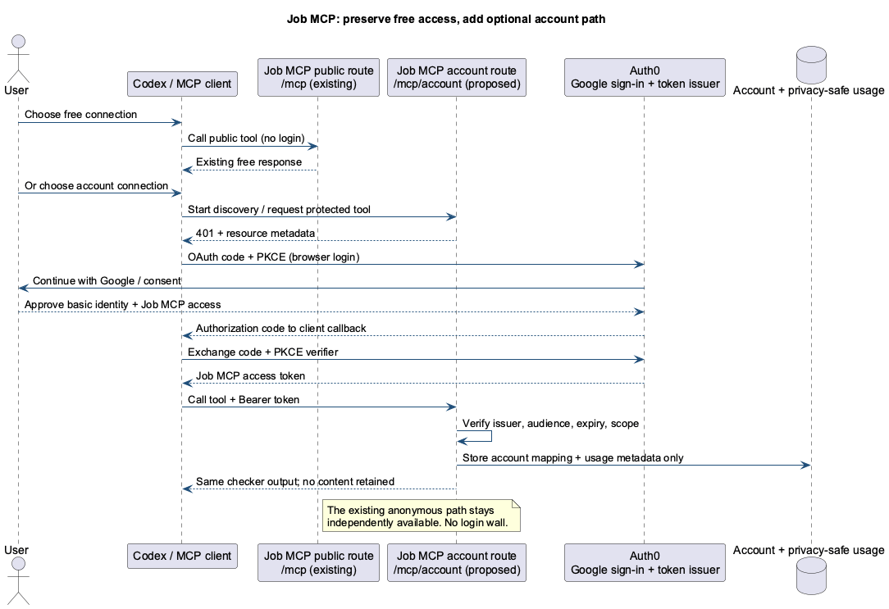
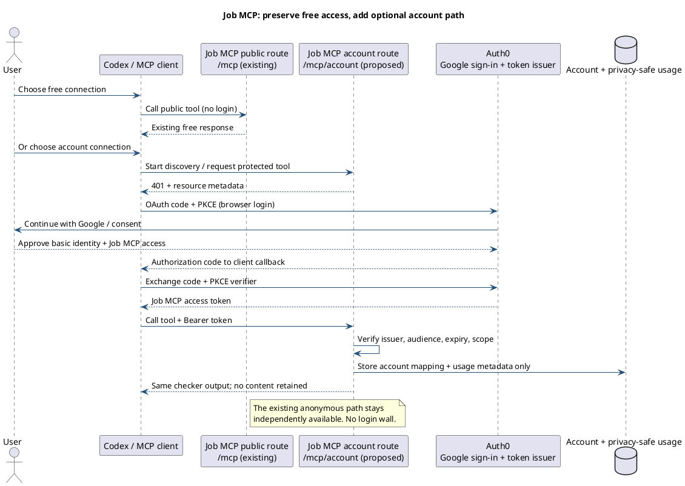
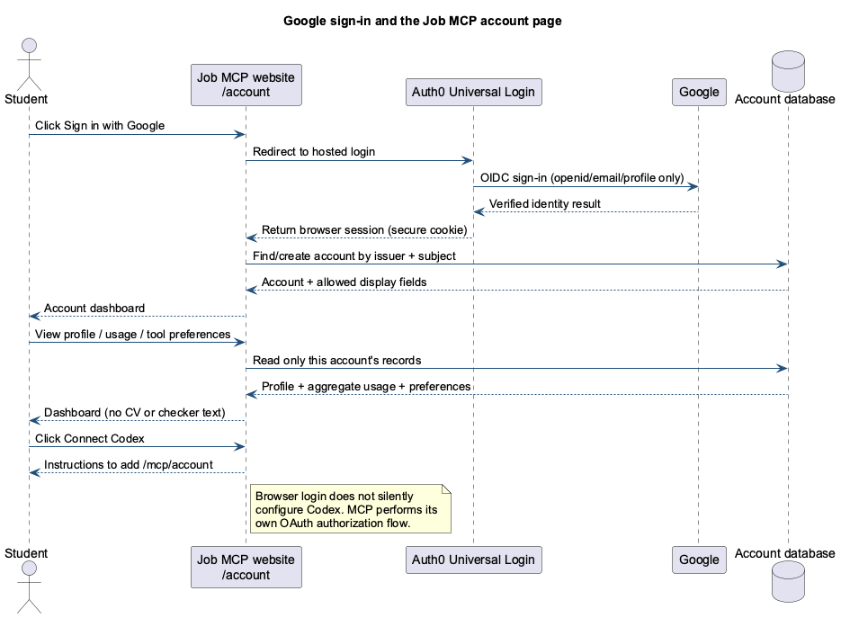
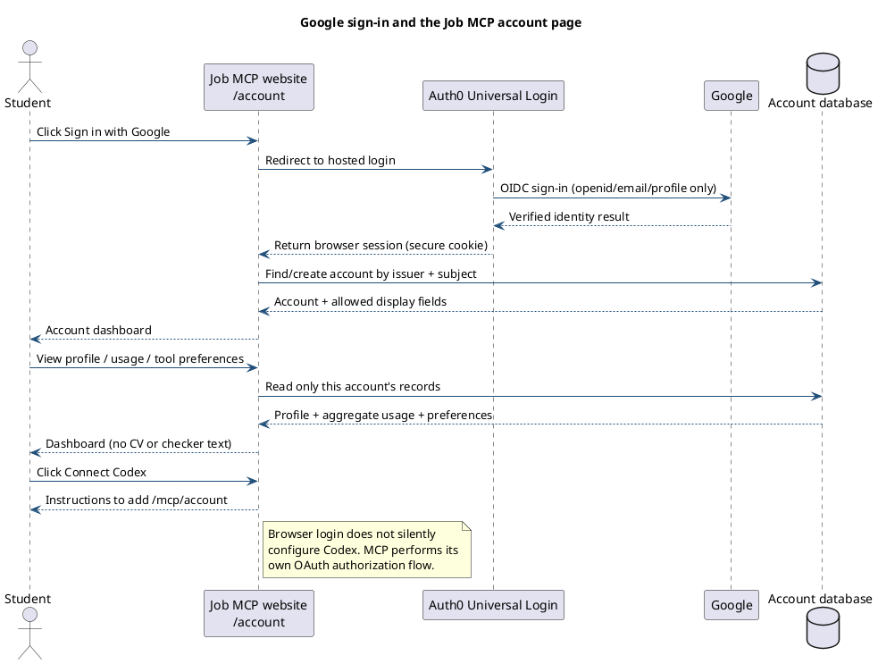
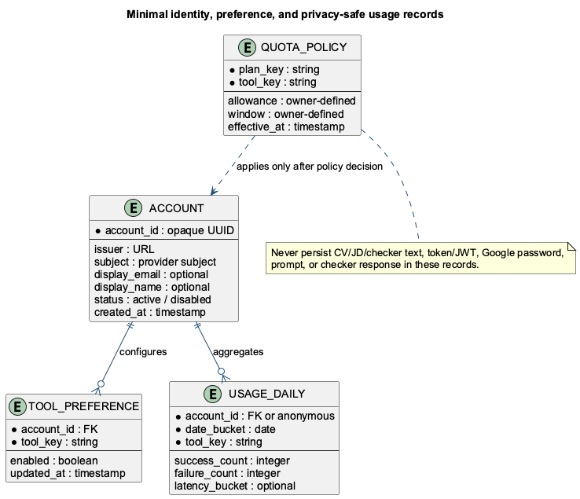
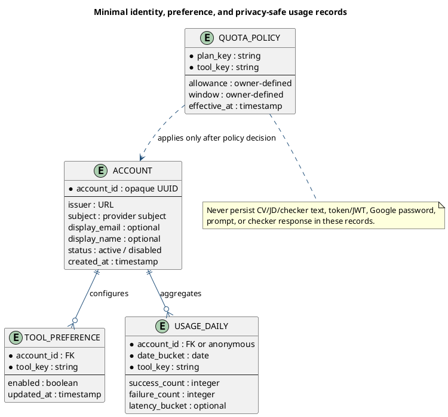
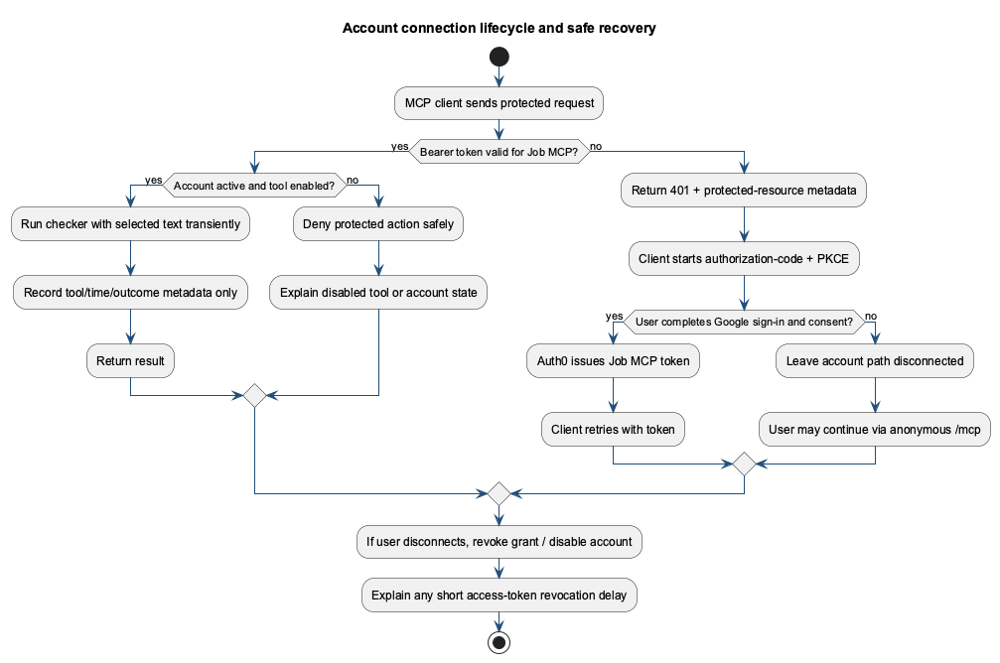
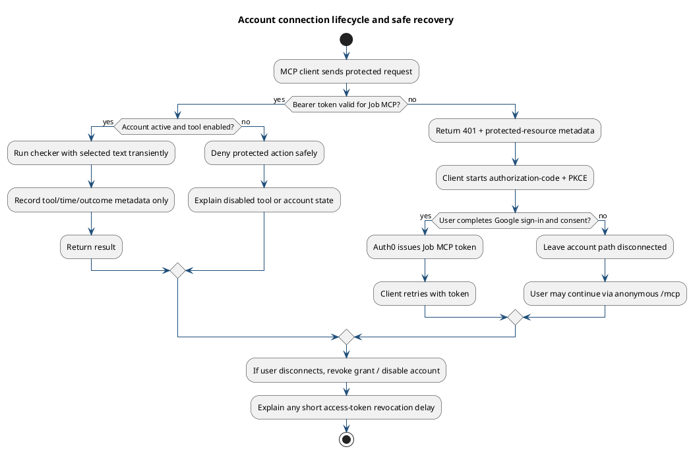

# Optional Google Sign-In and Account Path for Job MCP

**Document type:** Findings and implementation-planning note (not a Kiro specification)  
**Status:** Proposed; owner decisions and client compatibility tests remain before implementation  
**Prepared:** 22 October 2026

## Executive recommendation

Keep today's public MCP route and free anonymous tools working exactly as they do now. Add an optional authenticated path for users who choose Google sign-in. For the first release, use a separate OAuth-protected MCP route (provisionally `/mcp/account`) and an account page on the existing Job MCP website. Do not put a login wall in front of `/mcp`, change free-tool behavior, or collect student document text to create accounts or usage reports.

Use Google as the familiar sign-in button, but do not treat a Google login token as a Job MCP API key. Evaluate Auth0 first as the managed OAuth authorization server between Google and MCP clients. The user signs in through Auth0 Universal Login with Google; Auth0 issues a short-lived access token whose audience is Job MCP; Codex or another compatible MCP client stores/uses that token and sends it to the protected route. Job MCP validates the token on every protected request. The website's browser session is separate from Codex's MCP connection.

Before implementation, test the exact clients Cuong wants to support. OpenAI documents OAuth 2.1/PKCE and optional per-tool authentication for ChatGPT/Codex plugin surfaces. Other clients may differ in discovery, client registration, and optional-auth UX. The separate-route approach is the safe compatibility baseline; a single mixed-auth `/mcp` endpoint can be reconsidered only after those tests pass.

Initially, the account service should identify users, show account/usage information, allow users to revoke the authenticated connection, and manage a small set of server-enforced tool preferences. Do not invent quotas, prices, paid tiers, or limits here. Anonymous traffic remains anonymous and must not be reported as distinct people. Define any later account-based limits and the user-facing promise first.

## 1. Current system and non-negotiable constraints

The source-only checkout is `experimental/application-package-mcp/`; the live Franklee checkout is documented as `/DATA/AppData/application-package-mcp`, running in the `application-package-mcp` container. The public service is `https://jobmcp.pmlecuong.com/`, with MCP at `/mcp` and health at `/health`.

The README describes 11 public tools, including onboarding/application-kit tools plus `check_ats_resume_fit`, `check_writing_human_fit`, and `suggest_writing_revision`. Its privacy contract is local-first: candidate documents stay on the user's machine; selected writing text is sent only when the user asks for a check; submitted text is not stored. In `src/index.ts`, the optional `APPLICATION_MCP_TOKEN` check is applied at the entire `/mcp` HTTP boundary. If configured, it gates all calls with one shared bearer token; it is not a user-account system and cannot provide individual identities or per-user permissions. The existing public-health/release contract expects `tokenRequired: false`.

The source `docker-compose.yml` describes one application service and no account database. The source checkout deliberately omits Franklee runtime state and credentials. Production proxy, DNS/TLS, Cloudflare/Tailscale exposure, backups, database services, and any existing Auth0/Google project must therefore be inventoried on Franklee before exact deployment settings are chosen. This planning work has not inspected those live production details.

| Area | Existing contract | Plan must preserve |
|---|---|---|
| Anonymous access | Public MCP has no required token by default | Keep `/mcp` usable without sign-in and retain current free tools |
| Candidate data | CVs, job posts, drafts, and files stay local | Never require upload or profile ingestion for an account |
| Checker payloads | Selected text is transiently processed | Do not persist text, prompts, checker responses, or request bodies for analytics |
| Current auth | Optional shared service token | Do not mistake it for Google SSO or individual account auth |
| Deployment | One Node service in local Compose; no DB declared | Inspect Franklee before choosing a persistence topology |

### Product paths

**Path A — free/anonymous, unchanged.** Keep the current MCP URL, landing page, behavior, body-size guard, health/docs/resources, and privacy promise. Do not require Google or create accounts for this path. Do not call anonymous requests “users”; report calls or coarse anonymous aggregates. IP-derived signals are not unique-user identity. Any public abuse/rate-limit policy is separate and must not silently turn into an account count.

**Path B — optional authenticated.** Add a distinct route, provisionally `https://jobmcp.pmlecuong.com/mcp/account`, protected with OAuth 2.1 Authorization Code + PKCE. It can expose the same checker schemas/output while attaching verified account context. Store usage metadata only, never checker text. Add profile/usage/preferences tools only if target MCP clients can use their scopes reliably; the browser account page is the primary settings UI. The token's audience/resource must identify Job MCP. Validate signature, issuer, audience/resource, expiry, account status, and scopes for each protected action. If Auth0 or the account database is down, fail only the account path; the anonymous route must remain usable.

A second route isolates new auth middleware from the known public contract and avoids the existing global `APPLICATION_MCP_TOKEN` accidentally gating free tools. The trade-off is two connection choices (and perhaps two MCP entries for users who want both). Label them plainly: **Free — no sign-in** and **Google sign-in — account dashboard and account-level usage**.

After client testing, a future design may advertise individual tools with both `noauth` and `oauth2` schemes on one endpoint, so sign-in unlocks account-aware use. Treat that as a later decision, not a hidden first-release change. OpenAI documents this optional-auth pattern on its plugin surfaces, but the service must still enforce permissions and each target client must be tested.

## 2. How Google sign-in reaches Codex (plain-language flow)

Think of Google as the reception desk that checks identity, Auth0 as the office that issues a visitor badge for Job MCP, Codex as the person carrying the badge, and Job MCP as the door checking it.

1. The user starts **Add/Connect MCP server** inside a compatible MCP client. The Job MCP website may explain the steps, but it must not pretend that signing into `/account` has connected the MCP client.
2. The MCP client—not Job MCP's account page—starts OAuth authorization-code flow with PKCE and opens the authorization page in its supported browser context.
3. Auth0 shows **Continue with Google**. Google verifies the account and returns basic identity to Auth0. Job MCP never receives the Google password.
4. Auth0 requests consent for Job MCP access, then returns a short-lived authorization code to the exact redirect URI registered by the MCP client. For eligible ChatGPT connections, OpenAI currently documents a stable `chatgpt.com` redirect; the exact URI must be copied from that connection's management/setup UI and allowlisted, never guessed.
5. The client exchanges that code for an Auth0 access token using the PKCE verifier.
6. For protected calls Codex attaches `Authorization: Bearer <access-token>`. Job MCP validates signature, issuer, audience, expiry, and scope before executing a protected operation.
7. The web account page has its own browser login/session. Signing into the website does **not** silently configure Codex; the MCP client completes its own connection once.

The token the MCP client sends is not the Google ID token, password, or reusable shared API key. The account key should be the identity-provider issuer plus subject (`iss` + `sub`), not email or IP. Email can change and IP addresses can be shared. Store only profile fields needed for the account experience.

### Mobile and remote-computer support boundary (verified 22 October 2026)

There are three separate capabilities here; do not collapse them into one “mobile MCP” promise:

1. **Job MCP account website on a phone:** supported as a responsive website goal. The user can sign into `/account` in Android Chrome or iOS Safari, view account/usage settings, and sign out.
2. **ChatGPT Remote on Android controlling paired desktop Codex:** OpenAI documents this. Pair the phone once from ChatGPT desktop Settings → Connections → Control this Mac or PC (QR code). The Mac remains the execution machine; it must be awake, online, signed in to the same account/workspace, and have the necessary local permissions. Remote lets the user start, continue, steer, approve, and review supported desktop tasks.
3. **Adding/configuring a custom MCP server directly in ChatGPT mobile:** still documented as **web only**, not mobile. This does not negate Remote; Remote is a separate way to reach supported desktop Codex chats. It also does not mean that every custom MCP OAuth handoff from a phone into Codex is supported.

The plan must support the user's real phone-to-Mac operating pattern without claiming an unsupported mobile custom-MCP setup flow. Treat ChatGPT mobile Remote as the control plane and the paired Mac/Codex client as the execution/client environment. Make the Job MCP account experience phone-friendly; for MCP connection setup, give clear instructions to start from a supported client/surface and validate the exact return behavior there.

The previous Tailscale experience is a useful analogy for the *feeling* of the flow—approve identity in a browser, then return to the work surface—but it is not proof that the protocols or callbacks are interchangeable. Tailscale login authorizes access to a tailnet/device; ChatGPT Remote pairs a phone with a desktop; Job MCP OAuth grants an application-specific token. They are three distinct authorization/trust decisions. If Job MCP client OAuth is launched on the Mac and its authorization page is completed on the phone, test whether the exact supported client can resume at its registered callback. Never assume the website session, Tailscale session, or ChatGPT Remote pairing supplies the Job MCP token. Never ask users to copy authorization codes or bearer tokens between devices.

## 3. Sign-in and account UI

### Landing page

Add a small, non-blocking **Sign in / My account** entry. Keep existing free MCP setup visible and label anonymous connection as the default free option. Do not interrupt first-time users or imply sign-in is required for existing tools.

### Design-system discovery and extension process

The current source checkout does **not** contain a standalone design-system package or a reusable component library. The active `/` route is rendered by `renderCurrentLandingPage()` through `renderSiteChrome()` in `src/index.ts`; the active CSS tokens and shared site navigation/footer live in the `renderSiteChrome()` template. A separate `renderLandingPage()` template earlier in the same file has an older cream/green palette and is not the handler used for `/`. Treat the current root route and shared site chrome as the source of truth; do not copy the unused legacy palette into account pages.

The active site language to extend is:

| Design area | Existing source pattern | Account-area direction |
|---|---|---|
| Core colors | `--blue #071dff`, `--paper #f6f2e8`, `--white #fffdf6`, `--ink #090b10`, `--muted #5e6470`, `--line rgba(9,11,16,.16)`, `--yellow #edff45`, `--green #0a4c3f`, `--mint #dcf5e6`, `--dark #04050d` | Reuse semantic roles, not arbitrary hex values. Keep account workspace mainly paper/white/ink; use blue for brand/action emphasis and yellow sparingly for primary action/status accents. Never rely on color alone to communicate status. |
| Typography | Inter/system sans for body and most UI; Georgia for expressive display headings; monospace for technical labels | Keep dashboard headings practical and restrained; do not use oversized all-caps marketing type for account data. Preserve body family and readable line-height. |
| Brand/navigation | `Job MCP` mark, shared `renderSiteNav()` and `renderSiteFooter()` | Extend the shared navigation with a clear account identity/menu state; keep free setup and technical links distinct from signed-in account actions. |
| Layout | `1220px` content maximum; current responsive breakpoints at `1100`, `900`, and `560px`; `48px` button minimum height | Reuse the container and spacing rhythm where appropriate. Add an account-specific layout only where the workflow needs it. On narrow screens, collapse navigation and data layouts rather than scaling down desktop columns. |
| Surface treatment | Editorial hero, grid separators, white/cream surfaces, occasional dark command panels | Account UI should follow the Frontend skill's product-app guidance: calm, dense-but-readable, utility-first, minimal chrome, and no generic dashboard-card mosaic. Use a card only when it represents a real interactive entity. |

Before implementation, use this sequence:

1. **Verify the rendered baseline.** Capture the actual public landing page and existing `/start`, `/docs`, and `/privacy` pages at desktop and phone widths. Compare the public rendering with `renderCurrentLandingPage()`/`renderSiteChrome()` so stale deployment output or a mismatch is not mistaken for the design source. This planning pass inspected local source; it did not inspect or change the live server.
2. **Create a token inventory.** Record colors, typography, content widths, spacing, radii, borders, shadows, focus treatment, control heights, and breakpoints from the active source. Identify which are already semantic tokens and which are one-off values.
3. **Extend semantic tokens before adding components.** Add only missing meanings such as `success`, `warning`, `error`, `focus`, `disabled`, form-control surface, and account-page spacing. Map them to the existing palette after contrast checks. Do not introduce a second brand palette or a UI framework just to get a dashboard quickly.
4. **Make one shared source own the system.** If inline CSS prevents reliable reuse, the implementation task should extract the current token definitions and common primitives into a shared CSS/style module while keeping the existing server-rendered HTML contract. Avoid an unrelated React/SPA rewrite unless a later requirements/design decision justifies that added runtime and maintenance cost.
5. **Build a small component set around real account tasks.** Start with shared header/account navigation, primary and secondary buttons, labeled text fields, validation/help text, alerts, status badges, accessible switches, loading/empty/error states, usage summary rows, and a responsive usage-history representation. Each component must define default, hover/pressed, keyboard-focus, disabled, loading, success, and error states as applicable.
6. **Document and test the patterns once.** Add an implementation-time design-system page or visual fixture only if it can be kept out of the public product surface; otherwise use a local screenshot/story fixture. The design-system record should include tokens, component usage, do/don't examples, accessibility notes, and screenshots at representative widths. Browser tests should exercise the actual shared components inside the account flows, not a separate mock that can drift.
7. **Keep regression ownership with the feature.** When an account story or acceptance criterion changes, update the matching Playwright flow in the same implementation pass. Use role/name/label selectors or stable test hooks, capture console/page errors, and check the rebuilt runtime that users will receive.

### Responsive account experience

Design the account website as a responsive web application, while keeping the mobile-client limitation above explicit:

- **Phone (320–560 CSS px):** one-column content, compact brand/account header, vertically stacked form controls, full-width primary actions, usage metrics as short labeled rows, and usage history as readable stacked records instead of a squeezed wide table. No sideways page scrolling. Keep the account menu, sign-out, help, and privacy links reachable without hover.
- **Tablet (561–900 CSS px):** one-column or compact two-column layout only when labels and actions remain readable; navigation may wrap or become a button-controlled menu.
- **Desktop (901 CSS px and above):** use a restrained account shell with a narrow navigation/context rail only if it improves wayfinding; keep the main content aligned to the existing site container and avoid turning every metric into a card.
- **All sizes:** use semantic headings and landmarks, explicit labels and inline validation, visible keyboard focus, reduced-motion support, sufficient contrast, and touch targets with enough size/spacing. Test 200% text zoom and WCAG 2.2 reflow around a 320 CSS-pixel viewport. Prefer 44–48px controls for primary touch actions even though WCAG 2.2's minimum target criterion allows smaller targets when its spacing exception is met.
- **Auth recovery on mobile browser:** after cancel, provider error, session expiry, or a lost callback, show a plain retry/back-to-account path. Website login can return to the website session, but do not imply this recovers an MCP connection. The user must restart from the MCP client that owns the OAuth request. For a paired-Mac workflow, document how to switch back to ChatGPT Remote and continue on that Mac after authorization.

The current source breakpoints are starting evidence, not a requirement to preserve `560/900/1100px` exactly. The implementer should verify real wrapping, focus, and content behavior at representative devices, not only copy the existing media queries.

### First-time sign-in

1. User clicks **Sign in with Google**.
2. Auth0 Universal Login presents Google with clear Job MCP branding/consent.
3. Ask Google for identity scopes only: `openid`, `email`, `profile`. Do not request Drive, Gmail, Calendar, or unrelated Google API access.
4. The account service finds/creates an internal account using `(issuer, subject)` and minimal display metadata.
5. Browser returns to `/account` with a secure server-side session; user sees a short explanation and optional MCP setup instructions.
6. The account page may show setup instructions for supported clients. It must explain that connecting an MCP client is a separate authorization started from that client. Never copy a secret into MCP settings. Do not show a working-looking **Add a custom MCP server from ChatGPT mobile** action while OpenAI documents direct custom MCP setup as web-only. Explain separately that ChatGPT Remote can reach supported Codex chats on a paired desktop.

### MVP account page

- **My account:** display name and email only if needed, opaque account reference, provider, creation date; never show provider tokens.
- **Usage:** date range, counts by tool and success/failure, last activity. Show remaining quota/reset only after the owner approves a policy. Separate authenticated usage from anonymous aggregate calls.
- **Tool access:** explain each tool. Per-tool switches apply to authenticated access and are enforced by the server. A cached MCP listing is not permission; disabled calls must still be denied. Start with a small list, not a complex policy editor.
- **Connections:** show grants/client connections to the extent the provider exposes them. Offer **Disconnect/revoke** and explain that the user may also remove the MCP server from Codex settings. Do not promise the website can erase Codex's local token cache.
- **Privacy/deletion:** state what account/usage fields are retained and for how long. Offer self-serve deletion only once its behavior has been implemented and tested.
- **Support/recovery:** explain reconnect, switching Google accounts, expired/revoked access, and provider outages.

Never show CV text, job applications, checker input/output, or other document contents in the account dashboard. Do not store text to make usage charts.

### Account interaction and responsive states

The first account release should cover the states users actually encounter, not only the signed-in happy path:

| Surface | Required states and behavior |
|---|---|
| Sign-in entry | Signed out, sign-in in progress, provider canceled, provider error, session already active, and return to the same safe page. No indefinite spinner. |
| Dashboard | Loading, first-use/empty usage, populated usage, delayed/stale data, recoverable service error, signed-out/expired session, and disabled/deleted account. Label the time window and timezone. |
| Tool preferences | Enabled, disabled, saving, saved, failed-to-save, and stale-client-cache explanation. The server remains authoritative. |
| Connection/revocation | Current connection, disconnect confirmation, revocation pending/complete, revoked-token response, and reconnect instructions. State the actual token expiry/revocation delay once measured. |
| Navigation | Desktop navigation and phone menu, keyboard access, visible focus, current-page state, and no hover-only actions. If a drawer is used, a closed drawer must be hidden from the accessibility tree. |

Do not add a chart library unless the owner chooses charts after seeing the real usage scale. A few clearly labeled counts and a compact history are a better first release than a decorative card grid.

### Mobile and cross-device journeys

Treat these as separate:

1. **Website account sign-in:** user opens Job MCP `/account` on phone or laptop; the website redirects to Auth0; Auth0 uses Google; Auth0 returns the website's own secure session to `/account`.
2. **ChatGPT Remote to paired Mac:** user pairs Android ChatGPT with the Mac using the desktop Remote setup/QR flow. Later, the user opens Remote on Android and selects/continues a supported desktop Codex chat. The Mac runs the task with its local files, tools, and granted permissions.
3. **MCP client connection:** user starts adding Job MCP in a supported MCP client/surface; that client starts OAuth/PKCE; the authorization server returns to that client's exact registered callback; the client exchanges the code and stores its own token. If this flow is started on the Mac but Google login is completed in a phone browser, test the full return to the initiating client; do not represent this as ChatGPT mobile custom-MCP setup.

The account web session does not bridge or silently complete Journey 3. A phone browser session may sign the user into the Job MCP website, but it does not transfer the laptop's PKCE verifier, authorization code, or MCP token. Tailscale's network/device authorization and ChatGPT Remote's device pairing are also separate from Job MCP's app token. Do not build QR/device-code linking as a shortcut in v1 unless a later security review and product decision justify it.

### Tool-toggle meaning

A dashboard toggle is a server-enforced permission, not just a visual preference. Hiding a tool in `tools/list` is insufficient because clients can cache the list. A disabled call must be denied at execution time with a safe explanation and a refresh/reconnect hint. Recommended v1: per-account, per-tool boolean; no new paid tier implied. The exact toggle list and defaults need owner approval.

## 4. Owner setup checklist

Planning only: no Google project, secret, tenant, DNS, server, or production setting was changed.

### Google Cloud steps (owner)

1. Create/select a Google Cloud project owned by you/your organization, e.g. `Job MCP Login - Production`. Keep test and production separated if the project advances beyond a small pilot.
2. Configure Google Auth Platform/OAuth branding: application name, support email, authorized domains, homepage, privacy policy, and terms. Use the real Job MCP domain and publish the privacy explanation before public launch.
3. Choose **External** for users outside your Workspace. Keep **Testing** with named test accounts during pilot. Move to **In production** only after consent, support/privacy pages, security checks, and current verification requirements are understood.
4. Request only `openid`, `email`, and `profile`; do not request Google APIs unrelated to sign-in.
5. Create a Web application OAuth client for the Google-to-Auth0 social connection. Copy the exact Google callback URI shown by Auth0 into Google Authorized redirect URIs. This is Auth0's callback, **not Codex's**.
6. Put Google Client ID/Secret into the Auth0 Google connection using the provider dashboard/secret flow. Never place the secret in Git, frontend JS, MCP client config, screenshots, or this document.
7. Test with owner and pilot accounts. Before general release re-check Google's live branding and OAuth verification requirements. Identity-only scopes are simpler than sensitive Google API scopes but do not remove the need for valid branding, domain, privacy, and readiness.

### Auth0 steps (provider to evaluate first)

1. Create a development tenant, separate from production. Connect the Google social provider with the Web Client ID/Secret.
2. Create a Job MCP API/resource server with a stable identifier matching the canonical protected MCP resource URL.
3. Configure Authorization Code + PKCE S256, resource/audience handling, discovery metadata, and the client-registration model (CIMD, DCR, or pre-registration) for each supported MCP host.
4. Define minimum scopes. Candidate names: `account:read`, `usage:read`, `tools:manage`, `checker:use`. Confirm whether `checker:use` is needed if all calls at `/mcp/account` already require auth. Never grant access to local files/documents.
5. Verify Auth0 accepts MCP's `resource` parameter and produces a token with the exact Job MCP audience/resource. Auth0 documents a relevant compatibility setting; treat this as a test, not an assumption.
6. Set logout, token lifetime, grant revocation, account deletion, and monitoring. Enable refresh tokens only if the actual client requires them; prefer rotation; never store refresh tokens in Job MCP.
7. Before production, review current pricing, limits, log retention, data region, contractual and privacy terms. This note assumes no provider is free.

### Developer / Franklee steps

1. Inventory the actual Franklee proxy path, TLS, route exposure, backups, persistent volumes, disk/resources, existing database services, and existing identity accounts. The local checkout cannot establish these facts.
2. Host `/account` and `/mcp/account` under HTTPS. Keep `/mcp` unchanged. Ensure the reverse proxy preserves auth challenge and metadata headers.
3. Serve protected-resource discovery metadata and standard `401 WWW-Authenticate` challenges; configure CORS for supported clients without weakening authorization. Metadata is public; account data and protected operations are not.
4. Implement server-side bearer verification and per-tool/scope enforcement. Never trust identity or tool entitlement claimed by the client.
5. Select persistence only after inventory. Reuse an already-maintained database if available. Otherwise compare small PostgreSQL (relational/concurrent reporting, more operations) with SQLite on persistent storage (simpler pilot, single-writer and backup constraints). Choose after traffic assumptions and restore tests; avoid a DB solely for vanity analytics.
6. Store privacy-safe usage metadata only: account key + tool + time bucket + outcome + latency/status category. Never text, prompts, responses, CV/JD, email content, or token. Keep anonymous counters separate.
7. Build the small account page/APIs; run tests below; stage first. Keep all anonymous tests green throughout.
8. After pilot, decide quota, retention, cost, support needs, and whether toggles provide real value. Then convert accepted decisions into `.kiro/specs/`; this document is not the spec.

## 5. Service boundary and proposed records

**Franklee / Job MCP** remains the resource server and account web host. **Auth0** is the authorization server/identity broker and holds Google social-connection credentials. **Google** verifies the person. **Codex or another MCP client** is a public OAuth client using PKCE and holds its client-side token material. No password, Google Client Secret, access token, or refresh token belongs in the application database or browser local storage.

Use a secure server-side website session cookie (`HttpOnly`, `Secure`, appropriate `SameSite`) plus CSRF protection. The MCP bearer token is sent only to the authenticated MCP route. Keep browser and MCP connection lifecycle separate.

| Record | Minimum fields | Must never contain |
|---|---|---|
| `account` | opaque ID, issuer, subject, optional display name/email, lifecycle timestamps/status | CV/job text, Google password, raw OAuth tokens |
| `tool_preference` | account ID, tool key, enabled flag, updated time | inferred sensitive profile |
| `usage_daily` / aggregate | account ID or `anonymous`, date bucket, tool, outcome/count, latency bucket | request/response body, text excerpts, JWT |
| `account_audit` | account ID, action, timestamp, result, minimal session reference | raw content or tokens |
| `quota_policy` (only when decided) | plan, tool, allowance/window, effective dates | undocumented user promises |

Prefer daily aggregates or short-lived event diagnostics, not indefinite request rows. Publish retention before launch. Account deletion must say whether aggregate usage is deleted, anonymized, or retained under an explicitly reviewed lawful basis.

## 6. Disconnect, failure, and recovery

| Situation | User experience | System behavior |
|---|---|---|
| User declines sign-in | Continue with existing anonymous connection | Existing `/mcp` unchanged |
| Google login canceled | Calm retry option | Create no account without verified success |
| Wrong issuer/audience/signature/expiry | “Reconnect this service” | Reject; issue standard auth challenge; never fall through to privileged execution |
| MCP grant stale/revoked | Reconnect in client; browser authorization repeats | Revoke/expire grant; short token lifetime bounds stale access |
| Disconnect from account page | Confirm, then show reconnect instructions | Revoke the specific grant where provider allows; disable account if requested; invalidate refresh/grant state |
| Client still lists disabled tool | Explain cached listing and refresh | Enforce toggle at call time |
| Google/Auth0 outage | Account path reports temporary issue; anonymous remains available | Fail closed for authenticated tools, keep unrelated public tools running |
| Account DB outage | Account path unavailable with retry guidance | Never silently count authenticated request as anonymous or execute without entitlement check |
| Quota reached, if later approved | Show remaining/reset policy | Return clear quota result; no change to anonymous behavior absent separate decision |
| User loses Google account | Support/recovery route | Never auto-link based only on matching email |

Locally verified JWTs may remain valid until expiry after a grant is revoked. Set a short access-token lifetime and decide the maximum revocation delay. If immediate disable is required, add a DB/session-status check or denylist on each request, accepting extra latency and DB dependency. State the actual delay in the confirmation UI.

## 7. Phases and decisions for future Kiro spec

| Phase | Outcome | Exit gate |
|---|---|---|
| 0 — Decisions/compatibility spike | Confirm product boundary/provider candidate; inspect Franklee; inventory the live landing-page design; test OAuth discovery/PKCE with launch clients; confirm Google readiness/cost; verify ChatGPT Remote pairing separately from direct custom-MCP mobile setup; test any desired phone-browser-to-Mac OAuth return | No production auth. One supported test client completes Google → Auth0 → Job MCP token → protected test call; anonymous route unchanged. Record ChatGPT Remote-to-desktop as a supported distinct workflow; direct ChatGPT mobile custom-MCP setup remains unsupported unless OpenAI changes its documented position |
| 1 — Freeze public contract and visual baseline | Add regression coverage for current `/mcp`, all 11 tools, health/docs/resources, privacy boundary; capture active landing/site styles and phone/desktop screenshots; document current tokens and legacy-template mismatch | Existing public behavior, free tools, and `tokenRequired:false` contract pass with no login; actual rendered baseline is reconciled with source |
| 2 — Staging auth foundation | Auth0 dev tenant, Google login, metadata discovery, `/mcp/account`, token validation/scopes/errors | Valid token accepted; wrong audience/issuer/expiry/revoked rejected; old route remains anonymous; security review passes |
| 3 — Account portal, design-system extension, and data | Sign-in/out, account mapping, profile/usage, toggles, connection management, reusable design tokens/components, responsive account states, retention/deletion | Account isolation passes; toggles enforced; no raw content; backup/restore verified; UI matches the active Job MCP system; account pages pass keyboard, responsive, zoom, and accessibility checks |
| 4 — Pilot and production | Small tester cohort, support playbook, privacy/terms, Google readiness, rollback, monitoring, explicit supported-client and remote-device matrix | Owner approves cost, quota/retention/SLO; authenticated and anonymous staged and production checks pass. Mobile web account flow and ChatGPT Remote-to-paired-Mac workflow are verified separately; direct custom MCP setup in ChatGPT mobile is not claimed unless newly supported and verified |
| 5 — Optional consolidation | Keep two routes or consider mixed-auth single endpoint | Client matrix proves expected behavior; migration keeps existing users working |

### Owner decisions required before requirements are written

1. Is initial authenticated access a free pilot or a paid/limited tier? Recommended first answer: free pilot, no payment or quota promise.
2. Which exact clients and versions are launch-critical (Codex desktop/CLI, VS Code, Claude Desktop, Cursor, other)?
3. Does sign-in's initial value need to be account-counted ATS/humanizer use, or only profile/dashboard/connection management?
4. Which tool toggles matter? Account-wide preference or admin entitlement?
5. What event retention period is acceptable? Self-serve account deletion or request-based?
6. Is Auth0 acceptable after cost, privacy, region, and terms review? If not, assess Keycloak as a separate self-hosted operations effort.
7. What maximum delay to revoke access is acceptable?
8. What quota/abuse policy, if any, should apply? No numeric value is assumed here.

## 8. Testing and release gates

### Preserve anonymous behavior

- Run `npm ci`, `npm test`, and `python3 samples/local-kit-regression/run_regression.py`.
- No-auth `/mcp` still discovers and calls all existing tools with unchanged schemas/behavior.
- Free ATS and writing tools work without login and do not require a newly configured token.
- Anonymous health, landing, prompts, templates, and resources work.
- Automated privacy tests place sentinel text in requests and assert it never appears in logs, metrics, database, exceptions, or health output. Also assert no token/secret is logged.
- Keep current public auth/health monitoring semantics; report new route auth separately.

### Design-system and responsive browser coverage

- Snapshot the public landing page and at least one shared content page before implementation at desktop and phone widths. Compare with `renderCurrentLandingPage()`/`renderSiteChrome()` and resolve any source/runtime drift before extending styles.
- Verify shared tokens and components are used in both public and account pages. Assert against component semantics and accessible names; avoid brittle selectors tied to CSS class order.
- Test account sign-in, sign-out, expired session, profile, empty/populated usage, preference toggle success/failure, disconnect/reconnect, and account-service error at phone and desktop viewports.
- Include representative widths of 320, 375/390, 430, 768, 1024, and 1440 CSS px; test 200% zoom/reflow, keyboard-only navigation, focus visibility, reduced motion, and no body-level horizontal overflow.
- Test at least one current iOS Safari and Android Chrome browser for the website account experience when devices/emulators are available. Auth0 Universal Login has documented browser support for Safari on iOS and Chrome on Android; still verify the actual current versions and callback behavior.
- Validate layout and interaction on the rebuilt, served application. Capture screenshots and console/page errors. Check tables/usage rows, nav menu, buttons, form errors, and switch states with long email/display-name values.
- Use deterministic staging/test identities for repeatable automated OAuth journeys. Keep a separate small manual real-provider test for Google consent and callback behavior; never store test credentials or authorization codes in fixtures, logs, screenshots, or committed data.

### MCP-client OAuth and mobile-support matrix

- Test ChatGPT web custom-MCP setup and OAuth with the exact configured auth metadata/callback URI. Confirm PKCE S256, state/issuer checks, resource/audience, cancel, retry, reconnect, and callback error handling.
- Test ChatGPT Remote on Android as a separate user journey: pair phone and Mac, start/continue a supported desktop Codex chat, handle an approval, steer the task, review results, then verify expected behavior when the Mac is asleep/offline or signed out. Do not treat this as a test of direct MCP setup on mobile.
- If product requirements include starting Job MCP OAuth on the Mac and completing Google login in a phone browser, validate the whole browser → exact client callback → token exchange flow with the real target client. Verify cancellation and recovery too; a successful Google login alone is not a passing test.
- Test each additional target MCP client (for example Codex desktop/CLI) separately. Do not infer Codex desktop behavior from ChatGPT web, or ChatGPT mobile behavior from ChatGPT web.
- As of the research date, mark **direct ChatGPT iOS/Android custom-MCP setup: unsupported by current OpenAI Help Center documentation**. Separately mark **ChatGPT Remote access to supported desktop Codex chats: documented and supported**, subject to pairing, workspace/plan controls, and an available Mac. Recheck both statements before release; if direct mobile MCP support later appears, add a device-level app → browser → client-return test, not just a responsive screenshot.
- For supported clients that can open OAuth in an external browser, test both successful return and interrupted return. On interruption, user must be able to switch back to the initiating client and retry without copying a code/token, exposing a credential in a URL, or creating duplicate connection state.
- Test cross-device behavior explicitly: signing into `/account` on a phone must not be presented as having connected an MCP client running on a laptop. ChatGPT Remote can provide access to a supported Codex chat on the paired Mac, but its device pairing is not Job MCP OAuth. Start the actual MCP OAuth flow from the target client and validate any browser handoff end to end.

### OAuth/security

- Discovery has exact canonical issuer/resource, correct path-aware protected-resource metadata, scopes, and PKCE `S256`.
- Complete auth-code + PKCE with each supported client, including cancel, retry, reconnect, expiry, and refresh where applicable.
- Confirm the client sends a Job MCP audience token, never a Google ID token.
- Accept valid tokens; reject invalid signature, issuer/audience/resource, missing scope, expiry, malformed bearer, disabled account, and unknown subject.
- Verify `401 WWW-Authenticate` metadata challenge and CORS preflight; public metadata must not expose account data.
- Test state/nonce/CSRF, open redirect prevention, session fixation, secure cookie flags, logout, XSS-safe display fields, login abuse controls, and secret rotation.
- Verify Auth0's resource parameter/audience compatibility in the actual tenant.

### Isolation, usage, and operations

- Account A cannot read/change B's profile, usage, connections, settings, or quotas, including guessed IDs.
- Identity is `(iss, sub)`, not email/IP; test changed and duplicate emails.
- Account usage counts completed calls correctly under retry/timeout; define idempotency.
- Anonymous requests are never assigned to people or fingerprint-created accounts.
- Disabled tools are blocked server-side even if the client has cached `tools/list`.
- Dashboard labels date ranges, timezone, failures, account usage versus anonymous aggregate.
- Retention/deletion tests verify text is never stored and aggregate policy is followed.
- Test encrypted backups, restore, schema migration rollback, and least-privilege DB credentials.

### Release/rollback

- Run existing release gates in the MCP README/root AGENTS plus authenticated smoke tests.
- Check three surfaces independently: public landing/anonymous route, account portal, authenticated MCP discovery/calls.
- Stage with named testers; publish privacy/support/retention/deletion information before general availability.
- Use a rollback tag and preserve existing environment/data; confirm old `/mcp` works after rollback.
- Monitor auth error categories and latency without tokens or user content.

## 9. Risks and mitigations

| Risk | Mitigation |
|---|---|
| Free path accidentally becomes login-only | Separate route first; anonymous regression tests block release |
| Google token is accepted as MCP API token | Auth0 issues Job MCP resource-specific token; validate issuer/audience/signature/expiry/scope |
| Redirect/resource setup loops or fails | Staging spike; exact client matrix; test resource echo and audience |
| Unique-user count is overstated | Exact account count only after sign-in; anonymous means calls, never people |
| Student text leaks into analytics | Allowlist metadata fields; sentinel tests; short retention |
| Revocation is delayed | Short access-token lifetime; disclose delay; DB check only if needed |
| New DB adds operational risk | Inspect/reuse maintained DB; otherwise backup/restore gates; anonymous path independent |
| MCP clients differ | Separate auth route baseline; test exact versions before consolidation |
| Tool toggle is cosmetic | Check preference on every protected call |
| Provider cost/Google verification surprises | Recheck terms, pricing, and current Google rules with owner sign-off |

## 10. Diagrams

The standalone `.puml` files are canonical/editable. Each source is embedded below for the VS Code PlantUML Markdown preview. A matching PNG is included as a portable fallback; it is not a substitute for the editable source.

### 10.1 Anonymous and authenticated MCP paths

Editable source: [dual-mcp-paths.puml](diagrams/optional-auth/dual-mcp-paths.puml)

### 10.2 Google sign-in and account portal

Editable source: [google-login-and-dashboard.puml](diagrams/optional-auth/google-login-and-dashboard.puml)

### 10.3 Minimal account and usage data model

Editable source: [account-data-model.puml](diagrams/optional-auth/account-data-model.puml)

### 10.4 Revocation and recovery

Editable source: [revocation-and-recovery.puml](diagrams/optional-auth/revocation-and-recovery.puml)

## 11. Research references

Primary/official documentation reviewed on 22 October 2026. Auth0 is a recommendation to evaluate first, not the only viable provider. Keycloak is an alternative if self-hosting/control outweighs the additional operations work. Re-check support, terms, regional processing, pricing, client compatibility, and mobile/Remote behavior in Phase 0 and again before launch.

1. [OpenAI — Authentication for MCP plugin servers](https://developers.openai.com/plugins/build/auth): OAuth 2.1, PKCE, protected-resource metadata, token audience/verification, optional `noauth` + `oauth2`, and provider/client responsibilities.
2. [OpenAI — Codex MCP setup](https://developers.openai.com/learn/docs-mcp): Codex MCP configuration across CLI/IDE contexts; exact optional-auth UX still needs client-version testing.
3. [OpenAI — MCP server guide](https://developers.openai.com/plugins/build/mcp-server): MCP integration and authentication considerations.
4. [Auth0 — Auth for MCP is generally available](https://auth0.com/blog/auth0-auth-for-mcp-servers-generally-available/): current Auth0 MCP authorization, CIMD, and resource identifiers.
5. [Auth0 — Google social connection setup](https://developer.auth0.com/resources/labs/authentication/google-social-connection-to-login): configure Google OAuth Client ID/Secret in Auth0's Google connection.
6. [Auth0 — MCP audience/resource compatibility note](https://support.auth0.com/center/s/article/mcp-audience-error-with-auth0): provider-specific `resource` parameter setting to verify in the actual tenant.
7. [Google — OpenID Connect](https://developers.google.com/identity/openid-connect/openid-connect): Google Cloud project, OAuth credentials, redirect URI, branding, and identity layer.
8. [Google — OAuth production readiness](https://developers.google.com/identity/protocols/oauth2/production-readiness/overview): testing/publishing states, basic identity-scope behavior, production readiness.
9. [Google — OAuth verification guidance](https://developers.google.com/data-manager/api/devguides/concepts/oauth-verification): test users and verification planning; verify product-specific applicability before launch.
10. [Google — User authorization flow](https://developers.google.com/identity/oauth2/web/guides/how-user-authz-works): consent and revocation considerations.
11. [OWASP — OAuth 2.0 Security Cheat Sheet](https://cheatsheetseries.owasp.org/cheatsheets/OAuth2_Cheat_Sheet.html): PKCE, access/refresh token protection, and security practices.
12. [MCP TypeScript SDK — Authorization](https://ts.sdk.modelcontextprotocol.io/v2/serving/authorization): protected-resource metadata, issuer discovery, token verification, and challenges; exact compatibility with this repository's pinned SDKs must be checked before implementation.
13. [OpenAI Help Center — Connecting custom MCP servers in ChatGPT](https://help.openai.com/en/articles/12584461-connecting-custom-mcp-servers-in-chatgpt): current supported setup surface and explicit statement that direct custom MCP server connections are web-only, not mobile.
14. [OpenAI — MCP authentication](https://developers.openai.com/plugins/build/auth): current ChatGPT/Codex MCP OAuth flow, PKCE S256, issuer identification, and exact callback requirements. The documented callback is for the MCP client; it is not a Job MCP website callback.
15. [Auth0 Support — Universal Login mobile browser support](https://support.auth0.com/center/s/article/mobile-application-browser-support-for-auth0-universal-login): documented supported browser families for native mobile-app Universal Login; actual client and browser behavior still requires testing.
16. [W3C — WCAG 2.2 Reflow](https://www.w3.org/WAI/WCAG22/Understanding/reflow.html): reflow and text-resize intent, including avoiding two-dimensional scrolling for ordinary content.
17. [W3C — WCAG 2.2 Target Size (Minimum)](https://www.w3.org/WAI/WCAG22/Understanding/target-size-minimum): 24 CSS-pixel minimum target criterion and spacing exception; the plan recommends larger 44–48px primary touch controls as a usability target.
18. [OpenAI Developers — Working on your phone](https://developers.openai.com/training/walkthroughs/working-on-your-phone): ChatGPT Remote setup by pairing a phone with a desktop through QR; phone can start, review, approve, and continue supported tasks while the computer executes locally.
19. [OpenAI Help Center — ChatGPT Work and Codex](https://help.openai.com/en/articles/20001275-chatgpt-work-and-codex): distinguishes cloud Work/Codex from desktop Codex Remote access, explains mobile availability and local-computer dependencies.

## 12. Next step

Review the eight owner decisions in Section 7. Once account model, launch clients, provider, retention, and revocation target are confirmed, convert this note into a Kiro spec with requirements, design, and phased tasks. Until then, keep the existing public `/mcp` route and production system unchanged.
